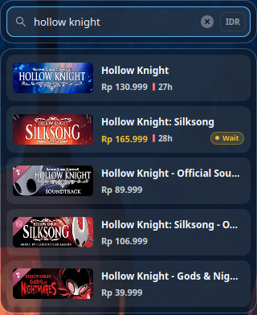
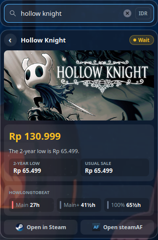
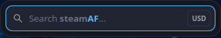

# 🛒 steamAF Widget for Steam Deck

<p align="center">
  
  &nbsp;
  
  <br /><br />
  
</p>

<p align="center">
  A tiny <b>KDE Plasma 6</b> desktop widget for the <b>Steam Deck</b> that brings
  <a href="https://steamaf.vercel.app">steamAF</a> to your desktop: search a Steam game and see
  whether today's price is <b>Worth it</b>, a <b>Good deal</b>, <b>No rush</b> or a <b>Wait</b>,
  plus how long it takes to beat.
  <br />
  Native QML front-end + a zero-dependency Python helper (standard library only). No daemon.
</p>

---

## ✨ Features

- **Just a search bar** (~54 px tall), so it stacks tightly with other widgets.
- **Floating island** for results and game detail: a rounded card right under the search bar,
  drawn *above* other widgets (up to 10 results, then scrolls). Typing keeps working while it is
  open; it closes when you click elsewhere and comes back when you focus the search again.
- **Typo-tolerant search** powered by steamAF, with capsule art, regional price, discount and
  a verdict badge for every result.
- **Game detail** (click a result):
  - steamAF verdict with the same colours as the website
  - current price, discount, original price
  - 2-year low and usual sale price, sale countdown when a sale is running
  - **HowLongToBeat** Main / Main+ / 100% times
  - quick links (with logos) to the Steam store page and steamAF
- **Optional Main Story hours on every result** (setting: *Show Main Story hours*): a small
  red-marked `27h` next to each price, fetched in the background and cached locally for 30 days
  (`~/.cache/steamaf-widget/hltb.json`) so repeated searches don't hit the API again.
- **44 Steam regions** – pick your currency in the settings (the `USD` chip in the search bar
  opens them). The choice is saved with the widget.
- **Solid or Glass background**, designed to sit next to the
  [Steam Deck Monitor](https://github.com/ryansetia1/steamdeck-monitor-widget) and
  [HLTB Search](https://github.com/ryansetia1/steamdeck-hltb-widget) widgets.
- **Results island background**: Auto (stays readable over other widgets), Same as widget,
  or Custom opacity.

## 📦 Install

```bash
git clone https://github.com/ryansetia1/steamdeck-steamaf-widget.git
cd steamdeck-steamaf-widget
./install.sh
systemctl --user restart plasma-plasmashell
```

Then right-click the desktop → **Add Widgets** → search for **steamAF** and drag it onto the desktop.
Size the widget box to just the search bar (~320×56); the island is a separate popup window.

To remove: `./uninstall.sh`.

## 🔧 How it works

```
plasmoid/
├── metadata.json
└── contents/
    ├── code/steamaf.py        # calls the steamAF API, prints JSON
    ├── config/                # currency + appearance settings
    ├── icons/steamaf.png      # AF logo for the "Open steamAF" button
    └── ui/
        ├── main.qml           # search card + island (PlasmaCore.Dialog) with results/detail
        ├── VerdictBadge.qml
        └── configGeneral.qml
```

The helper only runs when you search or open a game. It uses steamAF's public endpoints:

| Purpose | Endpoint |
|---|---|
| Search | `GET /api/search?q=…&cc=…` |
| Verdict badges for all results (one request) | `GET /api/status/snapshot?appIds=…&cc=…&country=…` |
| Game detail / verdict | `GET /api/extension/v1/verdict?appId=…&currency=…` (+ `refresh=1` when stale) |
| HowLongToBeat (detail, and per-result Main Story when enabled) | `GET /api/hltb?appId=…&title=…` |

Try it from a terminal:

```bash
python3 plasmoid/contents/code/steamaf.py search USD hades
python3 plasmoid/contents/code/steamaf.py detail IDR 1145360 Hades
python3 plasmoid/contents/code/steamaf.py hltb '[["1145360", "Hades"]]'
```

## 📄 License

GPL-2.0-or-later – see [LICENSE](LICENSE).
